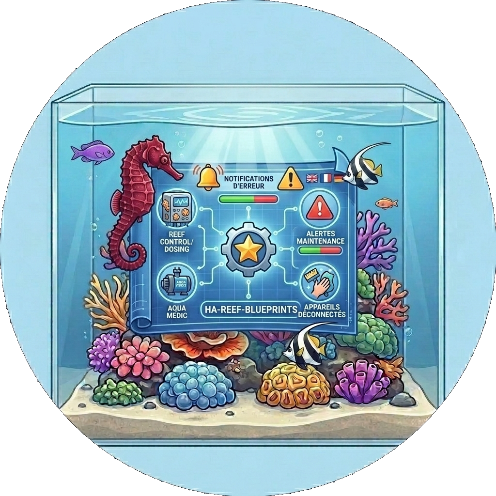

# Reef blueprints 🐬
> Part of the [**ReefTech Project Ecosystem**](https://elwinmage.github.io/reeftank/)

  

# Supported Languages:        

Home Assistant automation blueprints for the ReefTech ecosystem. They notify you on your phone about **overdue maintenance** and **unreachable devices**, whichever integration your equipment comes from.

<!-- ecosystem:start -->

## Related projects

The ReefTech projects fit together: the integrations bring your equipment into Home Assistant, the card displays and drives it, and the backup keeps it running through an outage. Each one also works on its own.

<table>
  <tr>
    <th width="100px"></th>
    <th>Project</th>
    <th>What it does</th>
    <th>Works with</th>
  </tr>
  <tr>
    <td></td>
    <td>🐠 <a href="https://github.com/Elwinmage/ha-reefbeat-component"><b>ha-reefbeat-component</b></a></td>
    <td>Red Sea ReefBeat devices, controlled locally with no cloud: ReefATO+, ReefControl, ReefControl-Power, ReefDose, ReefLed, ReefMat, ReefRun and ReefWave. alert blueprint for abnormal modes, calibrations and low battery. </td>
    <td>ha-reef-card</td>
  </tr>
  <tr>
    <td></td>
    <td>🌊 <a href="https://github.com/Elwinmage/ha-aquamedic-component"><b>ha-aquamedic-component</b></a></td>
    <td>Aqua Medic pumps through the Gizwits cloud API: EcoDrift and SmartDrift wavemakers, DC Runner return and skimmer pumps.</td>
    <td>ha-reef-card</td>
  </tr>
  <tr>
    <td></td>
    <td>🐙 <a href="https://github.com/Elwinmage/ha-reef-maintenance-component"><b>ha-reef-maintenance-component</b></a></td>
    <td>Cleaning and wear tracking for the equipment Home Assistant cannot talk to: flow pumps, return pumps, skimmers, media reactors, anything you service by hand.</td>
    <td>ha-reef-card</td>
  </tr>
  <tr>
    <td></td>
    <td>🪸 <a href="https://github.com/Elwinmage/ha-reef-card"><b>ha-reef-card</b></a></td>
    <td>Interactive graphical view of each device on your dashboard, and the only way to edit advanced schedules. Reads the three integrations above through the shared <code>reef_role</code> contract, with no card-side configuration. Also draws the power flows of reefbeatEnergyBackup.</td>
    <td>all three integrations</td>
  </tr>
  <tr>
    <td></td>
    <td>🐬 <b>ha-reef-blueprints</b> <i>(this repository)</i></td>
    <td>Notification blueprints shared by the whole ecosystem: overdue maintenance found through the <code>reef_role</code> contract, and devices that went unreachable. Eight languages.</td>
    <td>all three integrations</td>
  </tr>
  <tr>
    <td></td>
    <td>⚡ <a href="https://github.com/Elwinmage/reefbeatEnergyBackup"><b>reefbeatEnergyBackup</b></a></td>
    <td>Battery backup for power outages. A 24V LiFePO₄ pack driven by a Raspberry Pi, with pump speed degraded progressively according to the state of charge.</td>
    <td>standalone, or alongside ha-reefbeat-component and ha-reef-card</td>
  </tr>
</table>

All of them are documented together on the [ReefTech project page](https://elwinmage.github.io/reeftank/).

<!-- ecosystem:end -->

## Why a separate repository

Maintenance tasks are published by three integrations, so a blueprint watching them belongs to none of them in particular. It finds the tasks through the shared `reef_role` attribute, which means a future integration honouring the same contract is covered without republishing anything here.

Alerts specific to Red Sea hardware — abnormal modes, calibrations, ReefDose heads, ReefRun sensors — stay in [**ReefBeat watch**](https://github.com/Elwinmage/ha-reefbeat-component/tree/main/blueprints/automation), shipped with the integration that produces those entities and versioned with it.

## Installation

Pick your language and press the button. Home Assistant opens the import dialog; the blueprint then appears under **Settings → Automations & scenes → Blueprints**.

| | |
|---|---|
| **English** |  |
| **Français** |  |
| **Deutsch** |  |
| **Español** |  |
| **Italiano** |  |
| **Nederlands** |  |
| **Polski** |  |
| **Português** |  |

The languages are separate blueprints: importing two of them gives you two entries. Home Assistant has no translation mechanism for blueprints, which is also why this page is generated rather than written eight times.

## What it watches

- **Overdue maintenance.** Every button carrying a `reef_role` that starts with `maint_`, alerting when its `days_left` turns negative. No configuration: the tasks are discovered. Each task has its own notification switch, which the blueprint honours by default so you can mute one job without muting the rest.
- **Unreachable devices.** A device is reported when all of its entities are unavailable. This one takes an explicit device list, and the reason is worth knowing: Home Assistant strips the attributes of an unavailable entity, so `reef_role` disappears exactly when the device goes offline. Discovery is impossible here, so you choose what matters.

## Heater test

`reef_heater_test` proves that each heater can hold the tank on its own. One heater stays powered, the others are cut for the duration of the test, one heater per run in rotation. The result reaches your phone. The test stops early and restores the heaters on an excessive drop or below the abort temperature, and leaves the decision to anything else that touches the heaters in the meantime.

A meter makes the verdict a proof, since a warm room can hide a dead heater. It is found automatically for a Red Sea socket or a smart plug: the test then tells a dead heater from an undersized one, gives no verdict when the heater never drew power, and checks that the cut heaters really stopped drawing. A heater on a socket that follows a probe or a schedule is refused: set the socket to manual first. An optional text helper keeps the last result, and its history the earlier ones.

In summer a heater has nothing to do once the room reaches the tank or the setpoint, and a test would prove nothing, so give the room temperature and the setpoint: the test is then skipped and says why.

Heaters left off by a Home Assistant restart are turned back on two minutes after startup. Disabling the automation during a test is the one case it cannot recover from: finish the test first. To start a test yourself, use the automation's **Run** button for the next heater in the rotation, or fire the `reef_heater_test` event with `heater: switch.your_heater` to pick one.

| | |
|---|---|
| **English** |  |
| **Français** |  |
| **Deutsch** |  |
| **Español** |  |
| **Italiano** |  |
| **Nederlands** |  |
| **Polski** |  |
| **Português** |  |

## Relay watch

`reef_relay_watch` warns you when a relay reads off but its appliance still draws power: a welded contact, or a socket that no longer obeys. It checks every socket of the chosen ReefControl-Power and every port of the chosen ReefControl every five minutes, along with any smart plug you add, and also catches a contact that welds long after the switch went off. No test, nothing is switched.

| | |
|---|---|
| **English** |  |
| **Français** |  |
| **Deutsch** |  |
| **Español** |  |
| **Italiano** |  |
| **Nederlands** |  |
| **Polski** |  |
| **Português** |  |

## Good to know

- The automation runs every 5 minutes. It scans the `button` domain only, so the cost does not grow with the size of your installation.
- One notification per mobile device, tagged per device and alert type: a new alert replaces the previous one instead of stacking.
- Maintenance alerts are re-sent at a configurable interval (1–24 h, default 4 h). Unreachable-device alerts are sent once and do not repeat (`alert_once`).
- The Android channel field is ignored by iOS. Leave it as is if you only use iPhones.

## Development

`scripts/gen_blueprints.py` produces the YAML files from one template and one string table; `scripts/gen_readme.py` does the same for this page. Never edit the generated files: CI regenerates them and fails if the result differs.

`scripts/check_blueprints.py` is what stands in for a test suite. It parses every file, compares the inputs against the English reference, checks that each input is wired into a variable, and compiles the Jinja — an unbalanced tag otherwise only shows up as an automation that silently stops firing.
